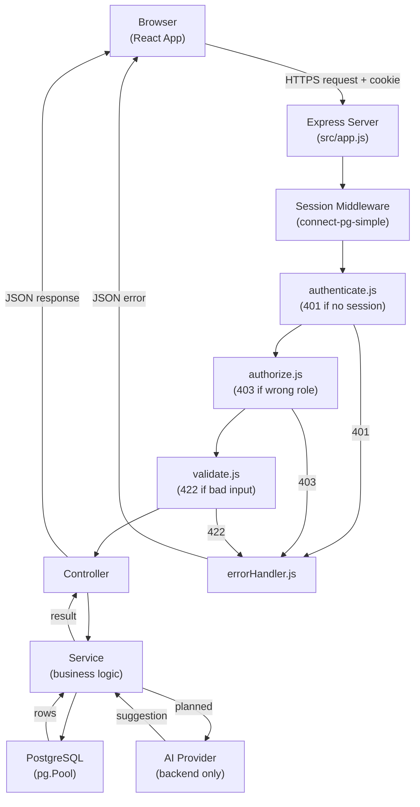
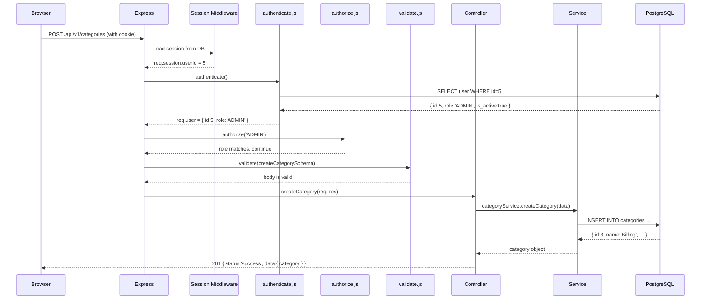
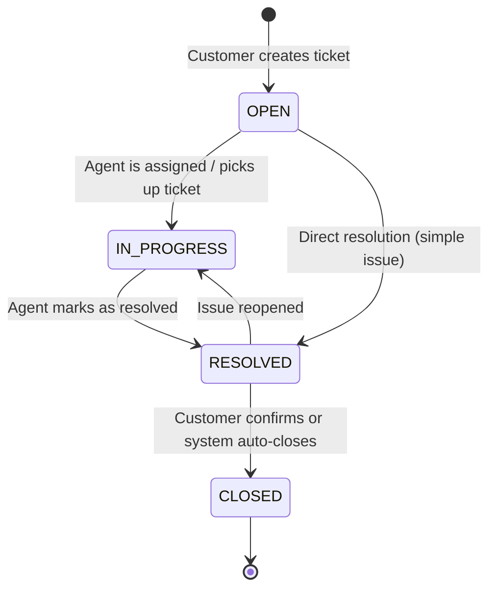

# 03 — System Architecture

This document explains how the AI Help Desk backend is structured, what each component is responsible for, and how a request flows through the system.

---

## Architecture Style: Modular Monolith

The backend is a **modular monolith**: a single Node.js process that contains well-separated modules for authentication, categories, tickets, comments, users, AI, and the dashboard. Each module manages its own routes, controllers, services, and validation.

### Why a modular monolith?

At this project's scope (a small-to-medium portfolio application with one developer), a modular monolith is the correct choice:

- **Simpler to develop** — There is one codebase, one server process, one database connection, and one deployment.
- **Simpler to test** — Integration tests can spin up the real server and test real database interactions without network stubs between services.
- **Simpler to debug** — All request handling is in one place; there are no network calls between services to trace.
- **Easy to split later** — Because business logic is isolated inside service files and database queries are kept in service or repository layers, a module could be extracted into a separate service later without rewriting the entire codebase.

Introducing microservices at this stage would add deployment complexity, distributed-tracing requirements, and inter-service authentication concerns that are not justified by the current scope.

---

## Component Responsibilities

### React Frontend *(Planned)*
The frontend is a React.js single-page application. It communicates with the backend REST API using `fetch` or React Query. It renders the user interface for ticket creation, listing, and detail views. It sends the session cookie automatically with every credentialed request. The frontend enforces route guards to redirect unauthenticated users, but those guards are a user-experience convenience — backend authorization is the real enforcement.

### Express REST API
The entry point is [`src/server.js`](../src/server.js), which starts the HTTP server. The Express application is configured in [`src/app.js`](../src/app.js), which mounts:

- Security middleware (Helmet, CORS, body parsers, session)
- Route groups under `/api/v1`
- A 404 fallback handler
- The global error handler

All API routes are prefixed with `/api/v1` to allow future versioning.

### Route Handlers
Each module defines a router file (e.g., [`auth.routes.js`](../src/modules/auth/auth.routes.js), [`category.routes.js`](../src/modules/categories/category.routes.js)). Route files attach middleware (authentication, authorization, validation) to specific paths and delegate to a controller.

### Controllers
Controllers extract data from `req.body`, `req.params`, and `req.query`, call the appropriate service function, and send the HTTP response. They contain no business logic and perform no database queries directly. Controllers are thin by design.

### Services
Service files contain the business logic: normalizing data, checking preconditions, performing database queries, and handling domain errors. For example, [`auth.service.js`](../src/modules/auth/auth.service.js) handles email normalization, bcrypt hashing, duplicate checks, and safe user retrieval. Services return plain JavaScript objects; they do not build HTTP responses.

### Authentication Middleware — `authenticate`
[`authenticate.js`](../src/middleware/authenticate.js) reads `req.session.userId`, queries the database for the current user, and attaches the result to `req.user`. If the session is missing, the user does not exist, or the account is deactivated, it returns `401 Unauthorized`. The role is always loaded from the database — it is never trusted from the client.

### Authorization Middleware — `authorize`
[`authorize.js`](../src/middleware/authorize.js) is a factory function. It accepts one or more allowed role names and returns middleware that checks `req.user.role`. If the role is not in the allowed list, it returns `403 Forbidden`. It always expects `authenticate` to have run first.

### Validation Middleware — `validate`
[`validate.js`](../src/middleware/validate.js) is a schema-based body validator. It checks types, required fields, length constraints, and patterns. It returns `422 Unprocessable Content` with a structured `errors` array when validation fails. Validation schemas are defined in module-level validation files (e.g., `category.validation.js`).

### Global Error Handler
[`errorHandler.js`](../src/middleware/errorHandler.js) is the last middleware in the chain. It converts `ApiError` instances into structured JSON responses. It converts malformed JSON into `400 Bad Request`. It converts any other error into `500 Internal Server Error` and logs it.

### PostgreSQL Database
PostgreSQL is the primary data store. The database connection is a `pg.Pool` configured in [`config/database.js`](../src/config/database.js). All queries use parameterized values (`$1`, `$2`, etc.) — user input is never interpolated into query strings.

### Session Store
Sessions are stored in PostgreSQL using `connect-pg-simple`. The session store uses a **dedicated connection pool** (separate from the main application pool) so that session reads and writes do not compete with business queries. The `sessions` table is created automatically on first use. Sessions expire after 24 hours. Expired sessions are pruned every 15 minutes.

### Backend AI Integration *(Planned)*
All AI requests are made by the backend, never by the browser. The backend validates the request, extracts only the necessary ticket fields, sends them to the configured AI provider, receives the response, and stores the suggestion in `ai_suggestions` with status `PENDING`. The API key is stored in an environment variable and is never sent to the client.

---

## Architecture Diagram



---

## Request Flow: Step by Step

The following sequence shows the path of an authenticated, authorized request.



---

## Ticket Lifecycle



Every status transition will be recorded in `ticket_history` (planned).

---

## Folder Structure

```
backend/
├── migrations/                   # SQL migration files
│   ├── 1792999534510_initial-schema.sql   # All 6 core tables (active)
│   └── 1729522800000_create-users-table.js # Earlier draft (superseded)
├── src/
│   ├── app.js                    # Express app: middleware and route mounting
│   ├── server.js                 # HTTP server, graceful shutdown
│   ├── config/
│   │   ├── database.js           # pg.Pool connection wrapper
│   │   ├── env.js                # Environment variable validation
│   │   └── session.js            # express-session + connect-pg-simple config
│   ├── middleware/
│   │   ├── authenticate.js       # Session auth → req.user
│   │   ├── authorize.js          # Role check factory
│   │   ├── errorHandler.js       # Global error → JSON response
│   │   └── validate.js           # Schema-based body validation
│   ├── modules/
│   │   ├── auth/                 # Register, login, me, logout
│   │   │   ├── auth.routes.js    # Rate limiting, validation schemas, routes
│   │   │   ├── auth.controller.js
│   │   │   └── auth.service.js
│   │   ├── categories/           # CRUD for ticket categories
│   │   │   ├── category.routes.js
│   │   │   ├── category.controller.js
│   │   │   ├── category.service.js
│   │   │   └── category.validation.js
│   │   ├── tickets/              # Ticket management (service started; routes empty)
│   │   │   ├── ticket.routes.js  # Empty — not yet implemented
│   │   │   ├── ticket.controller.js # Empty stub
│   │   │   ├── ticket.service.js # createTicket implemented; others planned
│   │   │   ├── ticket.repository.js # Empty stub
│   │   │   └── ticket.validation.js # Empty stub
│   │   ├── comments/             # Ticket comments (all stubs)
│   │   ├── users/                # User management (all stubs)
│   │   ├── ai/                   # AI integration (all stubs)
│   │   └── dashboard/            # Dashboard summary (all stubs)
│   ├── tests/
│   │   ├── auth.test.js          # Full auth flow integration tests
│   │   ├── auth.register.test.js # Registration-focused tests
│   │   ├── categories.test.js    # Full category management tests
│   │   └── health.test.js        # Health check and 404 tests
│   └── utils/
│       ├── ApiError.js           # Custom error class with statusCode
│       └── asyncHandler.js       # Wraps async handlers, forwards errors
└── docs/                         # This documentation
```

> [!NOTE]
> The `comments`, `users`, `ai`, and `dashboard` module directories exist with stub files only. No routes or business logic are implemented yet.

---

## Important Design Decisions

### Why `asyncHandler`?
Express 4 (and Express 5 with caveats) does not automatically catch errors thrown in `async` route handlers. Without `asyncHandler`, an unhandled Promise rejection would crash the server or hang the request. Every controller method is wrapped in `asyncHandler`, which catches any thrown error and passes it to the next middleware (the error handler).

### Why separate pools for session and application queries?
The session store reads and writes on every request. If it shared the main application pool, a spike in traffic could exhaust the connection pool for both sessions and business queries simultaneously. Using a dedicated pool ensures session operations and business queries have independent resources.

### Why load the user from the database on every request?
The `authenticate` middleware queries the database on every authenticated request to get the user's current role and `is_active` status. This is intentional: if an administrator deactivates a user account or changes their role, the change takes effect on the next request — not at session expiry. Trusting only the session would mean that a deactivated user could continue making requests until their session expires.

---

*Previous: [02 — Requirements](./02-requirements.md) | Next: [04 — Database Design](./04-database-design.md)*

