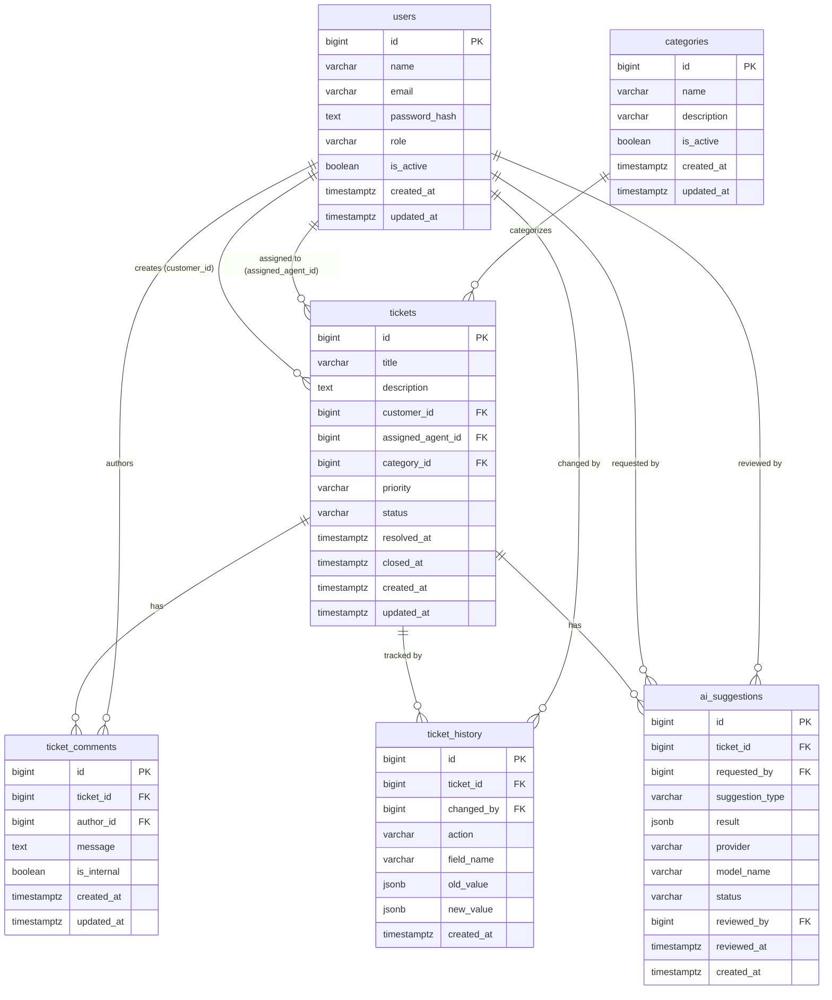

# 04 — Database Design

This document describes the actual PostgreSQL schema implemented in [`migrations/1792999534510_initial-schema.sql`](../migrations/1792999534510_initial-schema.sql). Every table, column, constraint, and relationship described here was verified against that file. Nothing has been invented.

---

## Overview

The database contains six core tables that together model the complete support ticket workflow.

| Table | Purpose |
|---|---|
| `users` | Stores all user accounts: customers, agents, and admins |
| `categories` | Stores configurable ticket categories |
| `tickets` | Stores each support request |
| `ticket_comments` | Stores messages and replies on a ticket |
| `ticket_history` | Audit log recording every change to a ticket |
| `ai_suggestions` | Stores AI-generated suggestions associated with tickets |
| `sessions` | Session store managed automatically by `connect-pg-simple` |

---

## Key Database Concepts

Before the table descriptions, here is a brief explanation of the database concepts used throughout.

**Primary key**: A column (or group of columns) that uniquely identifies every row in a table. Here, every table uses a single `id` column generated automatically by the database.

**Foreign key**: A column that stores the `id` of a row in another table. Foreign keys create relationships and prevent orphaned data (e.g., you cannot create a ticket that references a non-existent user).

**`ON DELETE RESTRICT`**: If you try to delete a user who has tickets, the database refuses the deletion. This protects historical data.

**`NOT NULL`**: The column must always have a value. An attempt to insert a row without that column's value will fail.

**`CHECK` constraint**: A rule the database enforces on every insert or update. For example, `status` must be one of `'OPEN'`, `'IN_PROGRESS'`, `'RESOLVED'`, or `'CLOSED'`.

**`UNIQUE` constraint**: No two rows may have the same value in that column (or group of columns).

**`TIMESTAMPTZ`**: A timestamp stored with timezone information. All timestamps in this schema default to `now()`, which is the current database server time.

**Parameterized queries**: Rather than building SQL strings that include user input (which would allow SQL injection attacks), the application uses `$1`, `$2`, etc. as placeholders and passes the actual values separately. PostgreSQL handles escaping automatically.

**`BIGINT GENERATED ALWAYS AS IDENTITY`**: An auto-incrementing integer primary key. The database generates the next value automatically; the application never supplies one.

**`JSONB`**: A binary JSON column. PostgreSQL can query and index inside JSONB values. Used for `ticket_history.old_value`, `ticket_history.new_value`, and `ai_suggestions.result`.

---

## Table Definitions

### `users`

Stores every person who uses the application.

```sql
CREATE TABLE users (
    id              BIGINT GENERATED ALWAYS AS IDENTITY PRIMARY KEY,
    name            VARCHAR(100)    NOT NULL,
    email           VARCHAR(255)    NOT NULL,
    password_hash   TEXT            NOT NULL,
    role            VARCHAR(20)     NOT NULL DEFAULT 'CUSTOMER',
    is_active       BOOLEAN         NOT NULL DEFAULT true,
    created_at      TIMESTAMPTZ     NOT NULL DEFAULT now(),
    updated_at      TIMESTAMPTZ     NOT NULL DEFAULT now(),
    CONSTRAINT users_role_check          CHECK (role IN ('CUSTOMER', 'AGENT', 'ADMIN')),
    CONSTRAINT users_name_not_blank      CHECK (length(trim(name)) > 0),
    CONSTRAINT users_email_not_blank     CHECK (length(trim(email)) > 0)
);

CREATE UNIQUE INDEX users_email_unique_ci ON users (lower(email));
```

| Column | Type | Notes |
|---|---|---|
| `id` | `BIGINT` | Auto-generated primary key |
| `name` | `VARCHAR(100)` | Display name. Cannot be blank or whitespace-only. |
| `email` | `VARCHAR(255)` | Login identifier. Stored as lowercase (normalized before insert). Unique regardless of case. |
| `password_hash` | `TEXT` | bcrypt hash of the password. The plain-text password is never stored. |
| `role` | `VARCHAR(20)` | One of `CUSTOMER`, `AGENT`, or `ADMIN`. Defaults to `CUSTOMER`. |
| `is_active` | `BOOLEAN` | `false` means the account is deactivated. Deactivated users cannot log in. |
| `created_at` | `TIMESTAMPTZ` | Set once at row creation. |
| `updated_at` | `TIMESTAMPTZ` | Updated manually by the application when the user record changes. |

**Important decisions:**
- Email uniqueness is enforced by a **case-insensitive unique index** (`lower(email)`), not a simple `UNIQUE` constraint. This means `Alice@Example.com` and `alice@example.com` are treated as the same email.
- The `is_active` flag allows an admin to disable a user without deleting their history. All foreign key references to this user remain intact.
- `password_hash` uses bcrypt with 12 rounds. bcrypt has a hard input limit of 72 bytes, so the application caps password length at 72 characters before hashing.

---

### `categories`

Stores the configurable set of ticket categories that customers select when creating a ticket.

```sql
CREATE TABLE categories (
    id          BIGINT GENERATED ALWAYS AS IDENTITY PRIMARY KEY,
    name        VARCHAR(80)     NOT NULL,
    description VARCHAR(500),
    is_active   BOOLEAN         NOT NULL DEFAULT true,
    created_at  TIMESTAMPTZ     NOT NULL DEFAULT now(),
    updated_at  TIMESTAMPTZ     NOT NULL DEFAULT now(),
    CONSTRAINT categories_name_key       UNIQUE (name),
    CONSTRAINT categories_name_not_blank CHECK (length(trim(name)) > 0)
);
```

| Column | Type | Notes |
|---|---|---|
| `id` | `BIGINT` | Auto-generated primary key |
| `name` | `VARCHAR(80)` | Category label shown to users. Must be unique. Cannot be blank. |
| `description` | `VARCHAR(500)` | Optional longer description. May be `NULL`. |
| `is_active` | `BOOLEAN` | Inactive categories are hidden from customers and agents. Existing tickets retain their category reference. |
| `created_at` | `TIMESTAMPTZ` | Set at creation. |
| `updated_at` | `TIMESTAMPTZ` | Updated by the application on every change. |

**Important decisions:**
- Case-insensitive uniqueness is enforced at the **application layer** (the service performs `LOWER(name) = LOWER($1)` checks before inserting or updating). A case-insensitive unique index is also created by the category integration test setup as a safety net.
- Deactivating a category does not break existing tickets — `tickets.category_id` retains the reference, and the application enforces that only active categories can be used for **new** ticket creation.

---

### `tickets`

The core table. Each row represents one support request submitted by a customer.

```sql
CREATE TABLE tickets (
    id                  BIGINT GENERATED ALWAYS AS IDENTITY PRIMARY KEY,
    title               VARCHAR(200)    NOT NULL,
    description         TEXT            NOT NULL,
    customer_id         BIGINT          NOT NULL,
    assigned_agent_id   BIGINT,
    category_id         BIGINT,
    priority            VARCHAR(20)     NOT NULL DEFAULT 'MEDIUM',
    status              VARCHAR(20)     NOT NULL DEFAULT 'OPEN',
    resolved_at         TIMESTAMPTZ,
    closed_at           TIMESTAMPTZ,
    created_at          TIMESTAMPTZ     NOT NULL DEFAULT now(),
    updated_at          TIMESTAMPTZ     NOT NULL DEFAULT now(),
    CONSTRAINT tickets_customer_fk         FOREIGN KEY (customer_id)       REFERENCES users(id)       ON DELETE RESTRICT,
    CONSTRAINT tickets_assigned_agent_fk   FOREIGN KEY (assigned_agent_id) REFERENCES users(id)       ON DELETE RESTRICT,
    CONSTRAINT tickets_category_fk         FOREIGN KEY (category_id)       REFERENCES categories(id)  ON DELETE RESTRICT,
    CONSTRAINT tickets_priority_check      CHECK (priority IN ('LOW', 'MEDIUM', 'HIGH', 'URGENT')),
    CONSTRAINT tickets_status_check        CHECK (status IN ('OPEN', 'IN_PROGRESS', 'RESOLVED', 'CLOSED')),
    CONSTRAINT tickets_title_not_blank     CHECK (length(trim(title)) > 0),
    CONSTRAINT tickets_description_not_blank CHECK (length(trim(description)) > 0),
    CONSTRAINT tickets_resolved_status_consistency
        CHECK ((status NOT IN ('RESOLVED', 'CLOSED')) OR (resolved_at IS NOT NULL)),
    CONSTRAINT tickets_closed_status_consistency
        CHECK ((status <> 'CLOSED') OR (closed_at IS NOT NULL))
);
```

| Column | Type | Notes |
|---|---|---|
| `id` | `BIGINT` | Auto-generated primary key |
| `title` | `VARCHAR(200)` | Short summary. Cannot be blank. |
| `description` | `TEXT` | Full description. Cannot be blank. |
| `customer_id` | `BIGINT NOT NULL` | FK → `users.id`. Required. The ticket owner. |
| `assigned_agent_id` | `BIGINT` | FK → `users.id`. Nullable. Set when an agent is assigned. |
| `category_id` | `BIGINT` | FK → `categories.id`. Nullable. Can be assigned at creation or later. |
| `priority` | `VARCHAR(20)` | One of `LOW`, `MEDIUM`, `HIGH`, `URGENT`. Defaults to `MEDIUM`. |
| `status` | `VARCHAR(20)` | One of `OPEN`, `IN_PROGRESS`, `RESOLVED`, `CLOSED`. Defaults to `OPEN`. |
| `resolved_at` | `TIMESTAMPTZ` | Set when status becomes `RESOLVED`. Enforced by constraint. |
| `closed_at` | `TIMESTAMPTZ` | Set when status becomes `CLOSED`. Enforced by constraint. |
| `created_at` | `TIMESTAMPTZ` | Set at creation. |
| `updated_at` | `TIMESTAMPTZ` | Updated on every change. |

**Important decisions:**
- `assigned_agent_id` is nullable because new tickets are unassigned.
- `category_id` is nullable because AI classification may happen after ticket creation.
- The status consistency constraints (`tickets_resolved_status_consistency`, `tickets_closed_status_consistency`) are enforced at the database level, so an application bug that forgets to set `resolved_at` will be caught before the data is written.
- `ON DELETE RESTRICT` on all foreign keys means you cannot delete a user or category that has existing tickets.

---

### `ticket_comments`

Stores every message posted on a ticket, from both customers and agents.

```sql
CREATE TABLE ticket_comments (
    id          BIGINT GENERATED ALWAYS AS IDENTITY PRIMARY KEY,
    ticket_id   BIGINT          NOT NULL,
    author_id   BIGINT          NOT NULL,
    message     TEXT            NOT NULL,
    is_internal BOOLEAN         NOT NULL DEFAULT false,
    created_at  TIMESTAMPTZ     NOT NULL DEFAULT now(),
    updated_at  TIMESTAMPTZ     NOT NULL DEFAULT now(),
    CONSTRAINT ticket_comments_ticket_fk  FOREIGN KEY (ticket_id) REFERENCES tickets(id) ON DELETE RESTRICT,
    CONSTRAINT ticket_comments_author_fk  FOREIGN KEY (author_id) REFERENCES users(id)   ON DELETE RESTRICT,
    CONSTRAINT ticket_comments_message_not_blank CHECK (length(trim(message)) > 0)
);
```

| Column | Type | Notes |
|---|---|---|
| `id` | `BIGINT` | Auto-generated primary key |
| `ticket_id` | `BIGINT NOT NULL` | FK → `tickets.id`. The ticket this comment belongs to. |
| `author_id` | `BIGINT NOT NULL` | FK → `users.id`. The person who wrote the comment. |
| `message` | `TEXT` | The comment text. Cannot be blank. |
| `is_internal` | `BOOLEAN` | `false` = visible to the customer. `true` = internal note, visible only to agents and admins. |
| `created_at` | `TIMESTAMPTZ` | Set at creation. |
| `updated_at` | `TIMESTAMPTZ` | Set at creation; updated if message editing is implemented. |

**Important decisions:**
- `is_internal` allows agents to leave private notes without the customer seeing them. The application layer must filter internal comments out of customer-facing responses.

---

### `ticket_history`

An append-only audit table. Every change to a ticket (status, assignment, priority) is recorded here. Rows in this table are never updated or deleted by normal application logic.

```sql
CREATE TABLE ticket_history (
    id          BIGINT GENERATED ALWAYS AS IDENTITY PRIMARY KEY,
    ticket_id   BIGINT          NOT NULL,
    changed_by  BIGINT,
    action      VARCHAR(40)     NOT NULL,
    field_name  VARCHAR(50),
    old_value   JSONB,
    new_value   JSONB,
    created_at  TIMESTAMPTZ     NOT NULL DEFAULT now(),
    CONSTRAINT ticket_history_ticket_fk     FOREIGN KEY (ticket_id)  REFERENCES tickets(id) ON DELETE RESTRICT,
    CONSTRAINT ticket_history_changed_by_fk FOREIGN KEY (changed_by) REFERENCES users(id)   ON DELETE RESTRICT,
    CONSTRAINT ticket_history_action_not_blank CHECK (length(trim(action)) > 0)
);
```

| Column | Type | Notes |
|---|---|---|
| `id` | `BIGINT` | Auto-generated primary key |
| `ticket_id` | `BIGINT NOT NULL` | FK → `tickets.id` |
| `changed_by` | `BIGINT` | FK → `users.id`. Nullable to support system-generated events. |
| `action` | `VARCHAR(40)` | A short label describing what happened, e.g., `TICKET_CREATED`, `STATUS_CHANGED`, `ASSIGNED`. |
| `field_name` | `VARCHAR(50)` | The name of the field that changed, e.g., `status`, `assigned_agent_id`. Nullable. |
| `old_value` | `JSONB` | The previous value. Nullable for creation events. |
| `new_value` | `JSONB` | The new value. |
| `created_at` | `TIMESTAMPTZ` | The time of the change. No `updated_at` because history rows are immutable. |

**Example rows:**

| action | field_name | old_value | new_value |
|---|---|---|---|
| `TICKET_CREATED` | `status` | `null` | `"OPEN"` |
| `STATUS_CHANGED` | `status` | `"OPEN"` | `"IN_PROGRESS"` |
| `ASSIGNED` | `assigned_agent_id` | `null` | `5` |
| `PRIORITY_CHANGED` | `priority` | `"MEDIUM"` | `"HIGH"` |

---

### `ai_suggestions`

Stores every AI-generated suggestion so that the review decision (accept/reject) can be tracked.

```sql
CREATE TABLE ai_suggestions (
    id              BIGINT GENERATED ALWAYS AS IDENTITY PRIMARY KEY,
    ticket_id       BIGINT          NOT NULL,
    requested_by    BIGINT,
    suggestion_type VARCHAR(30)     NOT NULL,
    result          JSONB           NOT NULL,
    provider        VARCHAR(80)     NOT NULL,
    model_name      VARCHAR(120)    NOT NULL,
    status          VARCHAR(20)     NOT NULL DEFAULT 'PENDING',
    reviewed_by     BIGINT,
    reviewed_at     TIMESTAMPTZ,
    created_at      TIMESTAMPTZ     NOT NULL DEFAULT now(),
    CONSTRAINT ai_suggestions_ticket_fk        FOREIGN KEY (ticket_id)    REFERENCES tickets(id) ON DELETE RESTRICT,
    CONSTRAINT ai_suggestions_requested_by_fk  FOREIGN KEY (requested_by) REFERENCES users(id)   ON DELETE RESTRICT,
    CONSTRAINT ai_suggestions_reviewed_by_fk   FOREIGN KEY (reviewed_by)  REFERENCES users(id)   ON DELETE RESTRICT,
    CONSTRAINT ai_suggestions_suggestion_type_check
        CHECK (suggestion_type IN ('CLASSIFICATION', 'SUMMARY', 'REPLY_DRAFT')),
    CONSTRAINT ai_suggestions_status_check
        CHECK (status IN ('PENDING', 'ACCEPTED', 'REJECTED')),
    CONSTRAINT ai_suggestions_result_object
        CHECK (jsonb_typeof(result) = 'object'),
    CONSTRAINT ai_suggestions_review_consistency
        CHECK (
            (status = 'PENDING' AND reviewed_by IS NULL AND reviewed_at IS NULL)
            OR
            (status IN ('ACCEPTED', 'REJECTED') AND reviewed_by IS NOT NULL AND reviewed_at IS NOT NULL)
        )
);
```

| Column | Type | Notes |
|---|---|---|
| `id` | `BIGINT` | Auto-generated primary key |
| `ticket_id` | `BIGINT NOT NULL` | FK → `tickets.id`. The ticket this suggestion is for. |
| `requested_by` | `BIGINT` | FK → `users.id`. Who triggered the AI request. Nullable (future system-initiated requests). |
| `suggestion_type` | `VARCHAR(30)` | One of `CLASSIFICATION`, `SUMMARY`, `REPLY_DRAFT`. |
| `result` | `JSONB` | The raw AI response. Must be a JSON object. |
| `provider` | `VARCHAR(80)` | The AI provider name, e.g., `openai`, `google`. |
| `model_name` | `VARCHAR(120)` | The specific model used, e.g., `gpt-4o`. |
| `status` | `VARCHAR(20)` | `PENDING` (not yet reviewed), `ACCEPTED`, or `REJECTED`. |
| `reviewed_by` | `BIGINT` | FK → `users.id`. Set when an agent or admin reviews the suggestion. |
| `reviewed_at` | `TIMESTAMPTZ` | Set when reviewed. |
| `created_at` | `TIMESTAMPTZ` | When the AI request was made. |

**Important decisions:**
- The `ai_suggestions_review_consistency` constraint enforces that `reviewed_by` and `reviewed_at` are always set together with a non-`PENDING` status. This prevents partial states (e.g., a suggestion marked `ACCEPTED` but with no reviewer).
- The `result` column stores the AI's full response. Different suggestion types have different structures, which JSONB handles without requiring separate tables.

---

### `sessions` (Managed by `connect-pg-simple`)

The session store table is created automatically when the server first starts, controlled by the `createTableIfMissing: true` option in [`config/session.js`](../src/config/session.js). Its structure is defined by `connect-pg-simple` and is not part of the application migration.

Its purpose is to map a session ID (the value in the `helpdesk.sid` cookie) to session data stored on the server (at minimum, the authenticated `userId`). Sessions older than 24 hours are considered expired. The store prunes expired sessions every 15 minutes.

> [!NOTE]
> The `sessions` table is not part of the SQL migration file. It is created and managed entirely by `connect-pg-simple`. Do not attempt to modify it manually.

---

## Entity-Relationship Diagram



---

## Planned Improvements

The following database changes are designed but not yet implemented:

### Performance Indexes

The schema does not yet include the following indexes. They should be added in a future migration when ticket listing and filtering endpoints are implemented.

```sql
-- Customer's tickets, newest first
CREATE INDEX idx_tickets_customer_created ON tickets (customer_id, created_at DESC);

-- Filter tickets by status
CREATE INDEX idx_tickets_status_created ON tickets (status, created_at DESC);

-- Agent's assigned tickets filtered by status
CREATE INDEX idx_tickets_agent_status ON tickets (assigned_agent_id, status);

-- Filter tickets by category
CREATE INDEX idx_tickets_category ON tickets (category_id);

-- Load ticket comments in order
CREATE INDEX idx_ticket_comments_ticket_created ON ticket_comments (ticket_id, created_at);

-- Load ticket history
CREATE INDEX idx_ticket_history_ticket_created ON ticket_history (ticket_id, created_at DESC);

-- AI suggestions for a ticket
CREATE INDEX idx_ai_suggestions_ticket_created ON ai_suggestions (ticket_id, created_at DESC);
```

### `updated_at` Triggers

Currently, `updated_at` is maintained manually in each UPDATE query (`SET updated_at = NOW()`). A PostgreSQL trigger would make this automatic and consistent. This should be added in a future migration.

---

*Previous: [03 — System Architecture](./03-system-architecture.md) | Next: [05 — API Documentation](./05-api-documentation.md)*

