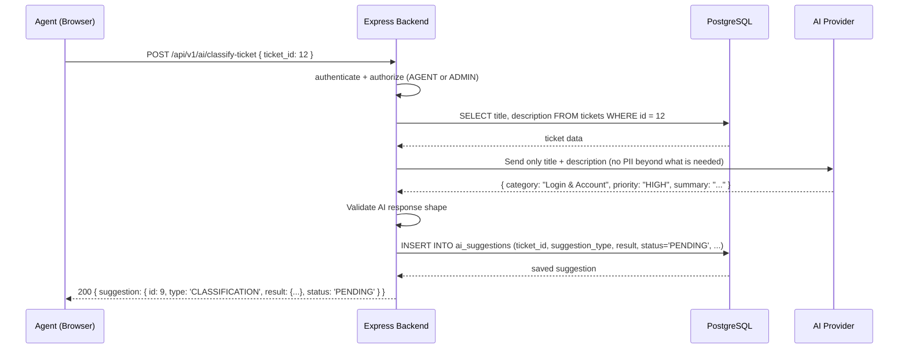

# 07 — AI Integration

This document explains how AI fits into the support workflow, why AI features are designed the way they are, and what safety rules govern them.

---

## Current State

> [!WARNING]
> The AI module (`src/modules/ai/`) exists as stub files only. The route file has no routes, the service file is empty, and the provider file is empty. The `ai_suggestions` database table is fully designed and created. The AI feature is **Planned**.

The schema is ready. The integration needs to be built.

---

## Purpose of AI in This System

AI assistance is a **tool for support agents**, not a decision-maker. Its goal is to reduce the time agents spend on routine tasks:

- Reading a new ticket and guessing which category it belongs to
- Assessing the urgency of an issue
- Drafting a first response to a common problem
- Summarizing a long conversation before replying

In all cases, a human agent sees the AI suggestion, decides whether it is correct, and chooses whether to use it. The AI does not automatically apply changes to tickets, users, or the database.

---

## Planned AI Features

### MVP Features

| Feature | Suggestion Type | Description |
|---|---|---|
| Ticket classification | `CLASSIFICATION` | Given a ticket's title and description, suggest a category and optionally a priority |
| Reply draft | `REPLY_DRAFT` | Given the ticket conversation, suggest a response the agent can review and edit |

### Future Features

| Feature | Suggestion Type | Description |
|---|---|---|
| Conversation summary | `SUMMARY` | Summarize the full comment thread of a long ticket |
| Priority suggestion | Included in `CLASSIFICATION` | Suggest a priority based on ticket content |

---

## Why AI Requests Must Come from the Backend

The AI API key must never be sent to the browser. If the key were used directly from frontend JavaScript, it would be visible to any user who inspects the network traffic. An exposed API key allows anyone to use the AI provider at the project owner's expense, with no rate limiting.

By routing all AI requests through the backend:

1. The API key stays in the server environment (an environment variable, never in source code).
2. The backend can validate the request, check the user's authorization, and limit which tickets are accessible.
3. The backend can sanitize the data sent to the AI provider before sending it.
4. The backend can handle failures, timeouts, and invalid responses centrally.

---

## Proposed Request Flow



The suggestion is stored with `status = 'PENDING'`. The ticket's actual category and priority are **not changed**.

---

## Suggestion Review Flow *(Planned)*

After an agent receives an AI suggestion:

1. The agent reviews the suggestion in the UI.
2. The agent may choose to **accept** or **reject** it.
3. If accepted: the agent still applies the suggested change manually (e.g., selecting the category from a dropdown). Acceptance is a record-keeping action, not an automatic update.
4. The review is recorded: `ai_suggestions` is updated with `status = 'ACCEPTED'` (or `'REJECTED'`), `reviewed_by`, and `reviewed_at`.

This design ensures that the AI never directly modifies ticket data. Every data change is a deliberate human action.

---

## Why AI Output Must Be Treated as Untrusted Input

An AI model can produce incorrect, outdated, biased, or unexpected output. The application must not:

- Automatically apply an AI-suggested category to a ticket without agent review
- Grant permissions based on an AI response (e.g., allowing an action because the AI said the user has a certain role)
- Trust that an AI response will always have the expected JSON shape
- Pass raw AI output directly to a database query without validation

The backend must validate the shape of every AI response before using it:

```js
// Example validation (planned)
if (typeof result.category !== "string" || result.category.trim().length === 0) {
  throw new ApiError(502, "AI provider returned an invalid classification response.");
}
```

---

## Handling Provider Failures

AI providers are external services that can fail, time out, or return errors. The backend must handle these gracefully:

| Failure | Handling |
|---|---|
| Network timeout | Return a `504 Gateway Timeout` or `503 Service Unavailable` to the client. Do not crash. |
| Invalid response shape | Log the raw response, return a `502 Bad Gateway` error. Do not save an invalid suggestion. |
| Provider API error (e.g., rate limited) | Return a descriptive error to the client. Avoid retrying immediately. |
| Provider unavailable | The rest of the application continues to work. AI features are degraded, not the whole system. |

---

## Protecting Sensitive Customer Information

Before sending ticket data to an AI provider:

- Send **only** the fields required for the suggestion (title and description for classification, comments for a reply draft).
- Do not send internal comments, customer email addresses, passwords, or session data.
- Refer to the AI provider's data processing agreement before sending personal data.

> [!CAUTION]
> If the AI provider uses submitted data for model training, submitting customer descriptions could expose personal information. Review the provider's privacy policy and terms of service before deploying AI features in production.

---

## Distinguishing AI Suggestions from Confirmed Data

The UI must clearly communicate that a suggestion is AI-generated and not confirmed:

- Label suggestions with a visible marker (e.g., "AI Suggestion — not yet applied")
- Show the `status` field (`PENDING`, `ACCEPTED`, `REJECTED`)
- Do not display an AI-suggested category as the ticket's actual category until the agent confirms it

In the API response, AI suggestions are returned from `/api/v1/ai/...` and `/api/v1/tickets/:id/ai-*` endpoints — never merged into the ticket's main data fields.

---

## What Is Not in Scope for AI

The following uses of AI are intentionally out of scope:

- Automatically responding to customers without agent review
- Making authorization decisions (e.g., "the AI decided this user should have admin access")
- Modifying ticket fields directly based on AI output
- Predicting customer satisfaction scores or agent performance
- Real-time chat bots

---

## Unresolved Design Decisions

| Question | Recommended Default |
|---|---|
| Which AI provider to use? | Not specified in the codebase. The `provider` and `model_name` columns in `ai_suggestions` allow any provider. Choose based on availability, pricing, and data privacy requirements. |
| How is the AI API key stored? | In an environment variable (e.g., `AI_API_KEY`). Never in source code or version control. |
| Should the AI provider be configurable at runtime? | For an MVP, hardcode the provider in the service. Make it configurable via environment variable when needed. |
| Should AI suggestions expire? | Not designed yet. Consider adding a `created_at` filter when listing pending suggestions. |

---

*Previous: [06 — Authentication and Authorization](./06-authentication-and-authorization.md) | Next: [08 — Development Roadmap](./08-development-roadmap.md)*

